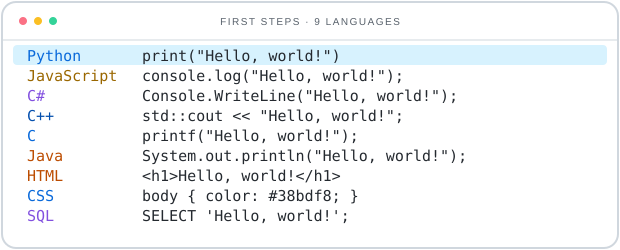
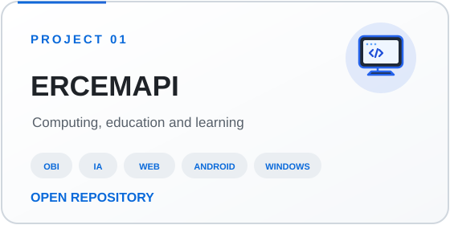
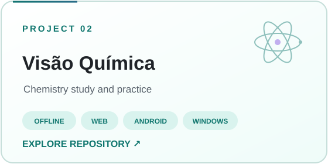
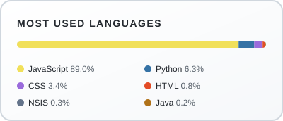

[🇧🇷 Português](README.md) · 🇺🇸 English

 

 

 

&nbsp;

 

## 💻 Technologies

<picture>
  <source media="(prefers-color-scheme: dark)" srcset="https://raw.githubusercontent.com/DiamondDust01/DiamondDust01/main/assets/tech-code-compact-en.svg" />
  <source media="(prefers-color-scheme: light)" srcset="https://raw.githubusercontent.com/DiamondDust01/DiamondDust01/main/assets/tech-code-compact-light-en.svg" />
  
</picture>
<picture>
  <source media="(prefers-color-scheme: dark)" srcset="https://skillicons.dev/icons?i=python%2Cjs%2Ccs%2Ccpp%2Cc%2Cjava%2Chtml%2Ccss%2Cmysql%2Cgit%2Cgithub%2Cvscode&theme=dark&perline=4" />
  <source media="(prefers-color-scheme: light)" srcset="https://skillicons.dev/icons?i=python%2Cjs%2Ccs%2Ccpp%2Cc%2Cjava%2Chtml%2Ccss%2Cmysql%2Cgit%2Cgithub%2Cvscode&theme=light&perline=4" />
  
</picture>

<em>Libraries for data analysis, machine learning and visualization</em>

&nbsp;&nbsp;&nbsp;&nbsp;&nbsp;&nbsp;&nbsp;&nbsp;&nbsp;&nbsp;

## 🚀 Featured projects

  <a href="https://github.com/DiamondDust01/ercemapi">
    <picture>
  <source media="(prefers-color-scheme: dark)" srcset="https://raw.githubusercontent.com/DiamondDust01/DiamondDust01/main/assets/ercemapi-featured-card-v4-en.svg" />
  <source media="(prefers-color-scheme: light)" srcset="https://raw.githubusercontent.com/DiamondDust01/DiamondDust01/main/assets/ercemapi-featured-card-light-v4-en.svg" />
  
</picture>
  </a>
  <a href="https://github.com/DiamondDust01/visao-quimica">
    <picture>
  <source media="(prefers-color-scheme: dark)" srcset="https://raw.githubusercontent.com/DiamondDust01/DiamondDust01/main/assets/visao-quimica-card-v2-en.svg" />
  <source media="(prefers-color-scheme: light)" srcset="https://raw.githubusercontent.com/DiamondDust01/DiamondDust01/main/assets/visao-quimica-card-light-v2-en.svg" />
  
</picture>
  </a>

## 📈 My GitHub

  
  &nbsp;
  

  <picture>
    <source media="(prefers-color-scheme: dark)" srcset="https://raw.githubusercontent.com/DiamondDust01/DiamondDust01/main/assets/top-langs-dark-en.svg" />
    <source media="(prefers-color-scheme: light)" srcset="https://raw.githubusercontent.com/DiamondDust01/DiamondDust01/main/assets/top-langs-light-en.svg" />
    
  </picture>

  <picture>
  <source media="(prefers-color-scheme: dark)" srcset="https://komarev.com/ghpvc/?username=DiamondDust01&style=for-the-badge&color=8B5CF6&label=VIEWS&labelColor=111827" />
  <source media="(prefers-color-scheme: light)" srcset="https://komarev.com/ghpvc/?username=DiamondDust01&style=for-the-badge&color=6D28D9&label=VIEWS&labelColor=57606A" />
  
</picture>

  <em>Every project is one more step in the journey of turning curiosity into knowledge. Thanks for making it this far!</em> 
  

