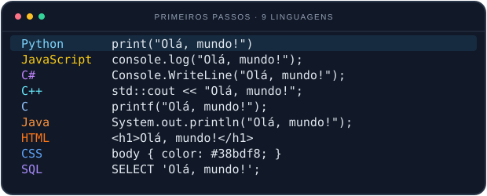
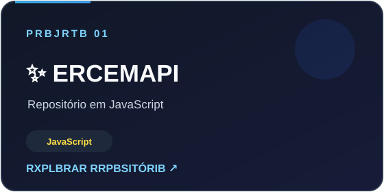
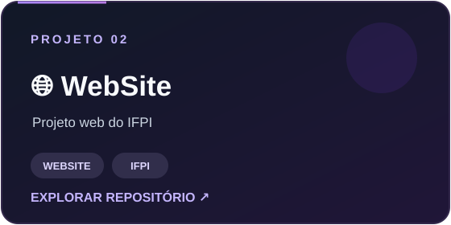

 

 

&nbsp;

 

## 💻 Tecnologias

<em>Bibliotecas para análise de dados, machine learning e visualização</em>

&nbsp;&nbsp;&nbsp;&nbsp;&nbsp;&nbsp;&nbsp;&nbsp;&nbsp;&nbsp;

## 🚀 Projetos em destaque

  
  

## 📈 Meu GitHub

  
  &nbsp;
  

  

  <kbd></kbd>

  <em>Cada projeto é um passo a mais na jornada de transformar curiosidade em conhecimento. Obrigado por chegar até aqui!</em> 
  

