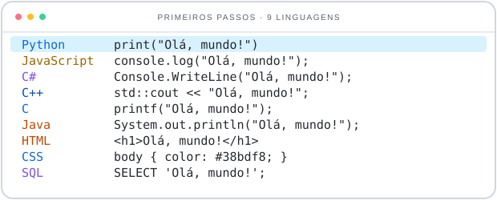
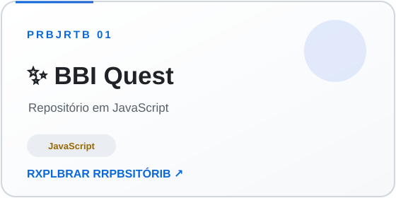
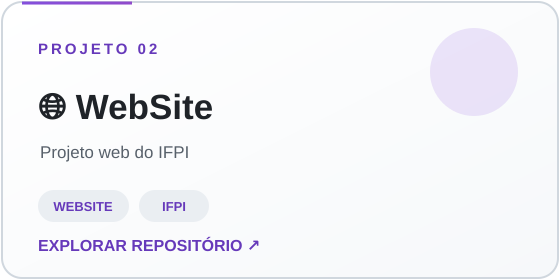

 

 

&nbsp;

 

## 💻 Tecnologias

<picture>
  <source media="(prefers-color-scheme: dark)" srcset="https://raw.githubusercontent.com/DiamondDust01/DiamondDust01/main/assets/tech-code-compact.svg" />
  <source media="(prefers-color-scheme: light)" srcset="https://raw.githubusercontent.com/DiamondDust01/DiamondDust01/main/assets/tech-code-compact-light.svg" />
  
</picture>
<picture>
  <source media="(prefers-color-scheme: dark)" srcset="https://skillicons.dev/icons?i=python,js,cs,cpp,c,java,html,css,mysql,git,github,vscode&theme=dark&perline=4" />
  <source media="(prefers-color-scheme: light)" srcset="https://skillicons.dev/icons?i=python,js,cs,cpp,c,java,html,css,mysql,git,github,vscode&theme=light&perline=4" />
  
</picture>

<em>Bibliotecas para análise de dados, machine learning e visualização</em>

&nbsp;&nbsp;&nbsp;&nbsp;&nbsp;&nbsp;&nbsp;&nbsp;&nbsp;&nbsp;

## 🚀 Projetos em destaque

  <a href="https://github.com/DiamondDust01/obi-quest">
    <picture>
  <source media="(prefers-color-scheme: dark)" srcset="https://raw.githubusercontent.com/DiamondDust01/DiamondDust01/main/assets/obi-quest-card.svg" />
  <source media="(prefers-color-scheme: light)" srcset="https://raw.githubusercontent.com/DiamondDust01/DiamondDust01/main/assets/obi-quest-card-light.svg" />
  
</picture>
  </a>
  <a href="https://github.com/DiamondDust01/WebSite">
    <picture>
  <source media="(prefers-color-scheme: dark)" srcset="https://raw.githubusercontent.com/DiamondDust01/DiamondDust01/main/assets/website-card.svg" />
  <source media="(prefers-color-scheme: light)" srcset="https://raw.githubusercontent.com/DiamondDust01/DiamondDust01/main/assets/website-card-light.svg" />
  
</picture>
  </a>

## 📈 Meu GitHub

  
  &nbsp;
  

  <picture>
  <source media="(prefers-color-scheme: dark)" srcset="https://github-readme-stats-eight-theta.vercel.app/api/top-langs/?username=DiamondDust01&layout=compact&theme=tokyonight&hide_border=true&border_radius=12&locale=pt-br" />
  <source media="(prefers-color-scheme: light)" srcset="https://github-readme-stats-eight-theta.vercel.app/api/top-langs/?username=DiamondDust01&layout=compact&theme=default&bg_color=ffffff&title_color=24292f&text_color=57606a&hide_border=true&border_radius=12&locale=pt-br" />
  
</picture>

  <picture>
  <source media="(prefers-color-scheme: dark)" srcset="https://komarev.com/ghpvc/?username=DiamondDust01&style=for-the-badge&color=8B5CF6&label=VISUALIZA%C3%87%C3%95ES&labelColor=111827" />
  <source media="(prefers-color-scheme: light)" srcset="https://komarev.com/ghpvc/?username=DiamondDust01&style=for-the-badge&color=6D28D9&label=VISUALIZA%C3%87%C3%95ES&labelColor=57606A" />
  
</picture>

  <em>Cada projeto é um passo a mais na jornada de transformar curiosidade em conhecimento. Obrigado por chegar até aqui!</em> 
  <picture>
  <source media="(prefers-color-scheme: dark)" srcset="https://capsule-render.vercel.app/api?type=waving&color=0:7C3AED,50:2563EB,100:0F172A&height=100&section=footer&animation=fadeIn" />
  <source media="(prefers-color-scheme: light)" srcset="https://capsule-render.vercel.app/api?type=waving&color=0:BFDBFE,50:DDD6FE,100:FFFFFF&height=100&section=footer&animation=fadeIn" />
  
</picture>

